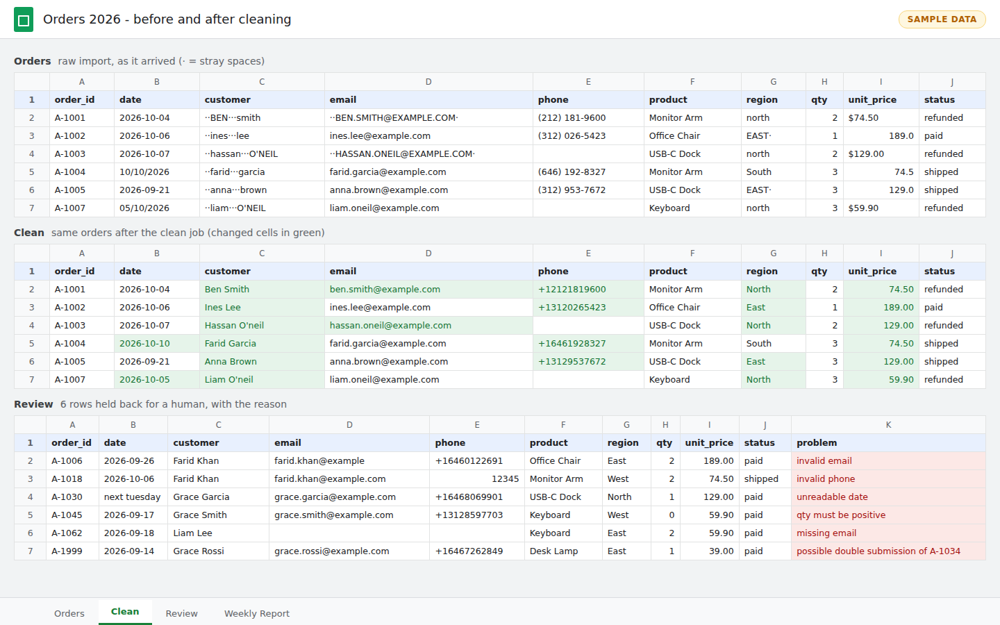
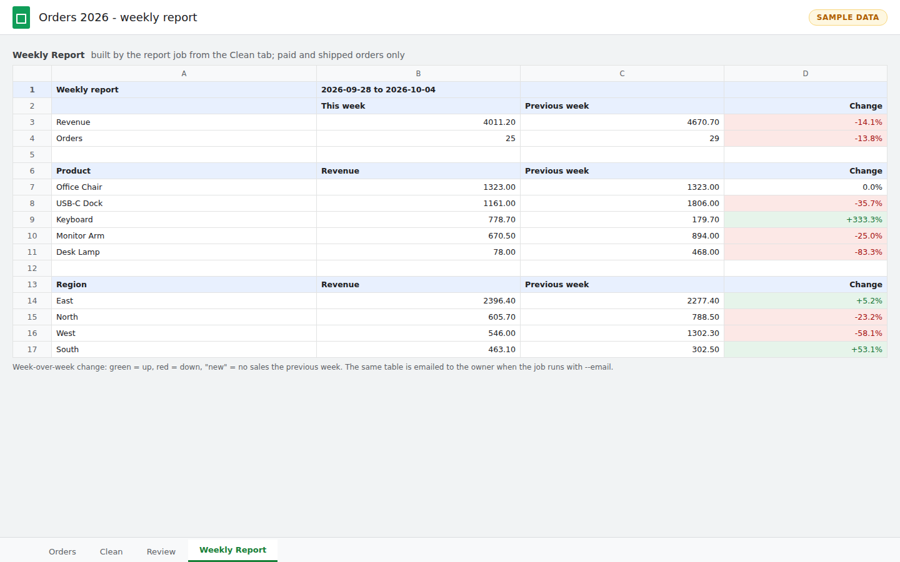
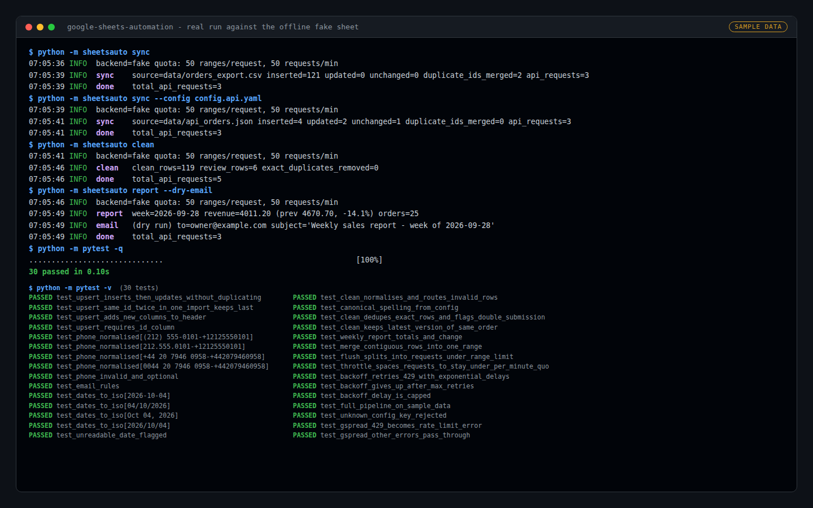

# Google Sheets Automation (Python)

Keep a Google Sheet up to date without copy-paste: pull orders in from a CSV export or an API, clean them, hold back bad rows for review, and build a weekly report, on a schedule.



## What it does

| Job | Command | What happens |
|---|---|---|
| **sync** | `python -m sheetsauto sync` | Reads orders from a CSV export or a REST API and **upserts** them into the `Orders` tab by `order_id`. New orders are appended, changed orders are updated in place, and an ID is never written twice. |
| **clean** | `python -m sheetsauto clean` | Trims stray spaces, fixes name casing, lower-cases emails, normalises phones to `+<country><number>`, turns mixed date formats into ISO dates, applies official product and region spellings, and removes exact duplicates. Rows that can't be trusted (bad email, unreadable date, zero quantity, likely double submission) go to a `Review` tab **with the reason**, not into the clean data. |
| **report** | `python -m sheetsauto report [--email]` | Builds a `Weekly Report` tab: revenue and orders for the last full week, by product and by region, with week-over-week change. It can email the same table. |
| **all** | `python -m sheetsauto all` | Runs all three in order, for a single cron entry. |



### Built to respect Google's limits

- **Batched writes:** row updates on consecutive rows are merged into one range, and ranges are sent together in `batch_update` calls (`max_ranges_per_request`).
- **Throttling:** requests are spaced to stay under the per-minute write quota (`requests_per_minute`, default 50 against Google's ~60).
- **429 handling:** a quota error is retried with exponential backoff (1s, 2s, 4s, ...) plus jitter. The delay is capped, and the job gives up after `max_retries`.

All three behaviours are covered by tests.

## Try it in 30 seconds (no Google account needed)

The demo config uses an offline **fake spreadsheet** (`output/fake_sheet.json`) and the sample data in `data/`.

```bash
python -m venv .venv && source .venv/bin/activate    # Windows: .venv\Scripts\activate
pip install -r requirements-dev.txt

python -m sheetsauto sync                             # 121 orders from data/orders_export.csv
python -m sheetsauto sync --config config.api.yaml    # API feed: status updates + new orders
python -m sheetsauto clean
python -m sheetsauto report --dry-email               # builds the report and prints the email it would send
python -m pytest -q
```



The resulting tabs from that run are saved in `output/` as `orders_tab.csv`, `clean_tab.csv`, `review_tab.csv` and `weekly_report_tab.csv`, together with the run log. The sample data (`scripts/make_sample_data.py`, fixed seed) is fake and contains deliberate problems: messy spacing and casing, four date formats, three phone styles, `$1,234.00` prices, an invalid email, a missing email, a bad phone, an unreadable date, a zero quantity, a duplicate export and a double submission. The clean job catches all of them.

## Connect it to a real Google Sheet

1. In [Google Cloud Console](https://console.cloud.google.com/), create a project and enable the **Google Sheets API** (and the **Google Drive API**).
2. Under **IAM & Admin > Service accounts**, create a service account, then **Keys > Add key > JSON**. Save the file as `service_account.json` next to the config. It is git-ignored; never commit it.
3. Open your spreadsheet, click **Share**, and give the service account's email (`...@...iam.gserviceaccount.com`) **Editor** access.
4. Copy the ID from the sheet URL (`https://docs.google.com/spreadsheets/d/<ID>/edit`) into `config.example.yaml` as `spreadsheet_key`, then rename the file to `config.yaml`.
5. Set the source (`type: csv` with a path, or `type: api` with a URL), your country code for phone numbers, and the official product and region spellings.
6. Run `python -m sheetsauto all`.

To email the weekly report, fill in the `smtp` block and export the password as an environment variable (`SMTP_PASSWORD` by default). It is never stored in the config.

## Schedule it

**Linux / macOS (cron)**: every hour, plus the report on Monday at 07:00:

```cron
0 * * * *  cd /opt/sheets-automation && .venv/bin/python -m sheetsauto sync && .venv/bin/python -m sheetsauto clean >> sheetsauto.log 2>&1
0 7 * * 1  cd /opt/sheets-automation && SMTP_PASSWORD=... .venv/bin/python -m sheetsauto report --email >> sheetsauto.log 2>&1
```

**Windows (Task Scheduler)**: create a task with:
- Program: `C:\sheets-automation\.venv\Scripts\python.exe`
- Arguments: `-m sheetsauto all`
- Start in: `C:\sheets-automation`
- Trigger: daily, repeating every hour

## Project layout

```
sheetsauto/
  backend.py   SheetsBackend interface, GspreadBackend (Google), FakeBackend (offline)
  quota.py     BatchWriter: merge ranges, throttle, exponential backoff on 429
  sync.py      CSV / API loaders and the upsert-by-ID logic
  clean.py     normalisation rules, dedupe, review routing
  report.py    weekly report maths, SMTP mailer
  jobs.py      job runners used by the CLI and tests
  cli.py       python -m sheetsauto {sync,clean,report,all}
config.yaml          offline demo config
config.api.yaml      demo: second sync from an API-style JSON feed
config.example.yaml  production template for a real Google Sheet
tests/               30 offline tests (no network, no Google account)
```

## Tests

```bash
python -m pytest -q
```

The tests cover:
- upsert: inserts, in-place updates, no duplicate IDs, new columns
- every cleaning rule, plus duplicate and double-submission handling
- the weekly report maths and week-over-week change
- range merging, request splitting and throttling
- backoff timing, cap and give-up
- mapping Google's HTTP 429 to a retry
- the full pipeline on the sample data

The Google backend is checked through its error mapping only. The suite never calls Google.

## License

MIT, see [LICENSE](LICENSE).

---

Need your own spreadsheet workflow automated? Available for hire on Upwork.
